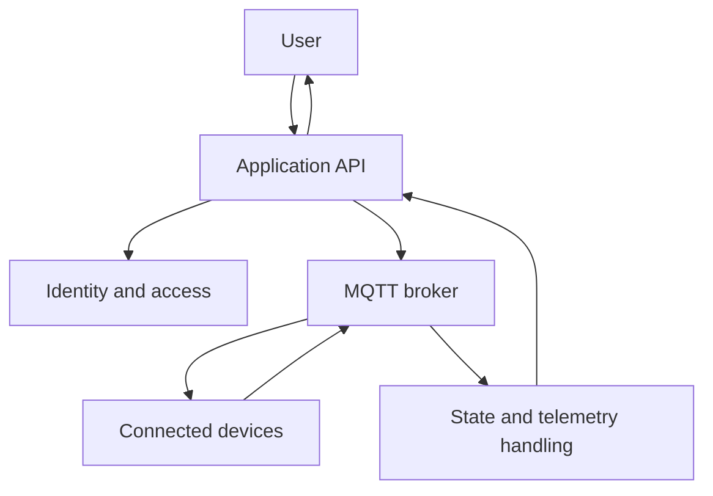

## Why I wrote this

IoTNet started as a way to control a few devices. Once several users shared the platform, the hard questions moved away from the protocol.
I had to know who owns a device, who may control it, what state it is really in, and what happens when it drops off the network.

## A command is not a result

When a user clicks a control, the platform can check the request and publish a command. That only proves it tried.
The device may have restarted, the broker may have reconnected, or the message may never have arrived.
So the interface shows the state the device reports back, not the action the user asked for.

HTTP serves the people using the app, and MQTT carries the device traffic. The backend sits between them and turns each side's messages into the other's.

## What was harder than I expected

- **State after a reconnect.** Sending a command was easy. Showing the right state after a device or the broker reconnected took more work.
- **Access.** As soon as several users shared devices, every command needed an ownership check before it reached the broker.
- **Automations.** They had to be flexible without becoming unpredictable. I kept them as event, condition, decision, and action, so I can inspect a rule after it misfires.
- **Tracing.** One failure can involve a device, the broker, an API request, and a background job. Logs and traces are how I find which one, so I added OpenTelemetry early.

## What I would keep

1. Keep user-facing API work separate from device messaging.
2. Check authorization on every device action, not only in the interface.
3. Treat a published command and an observed state as different things.
4. Keep automation rules explicit enough to inspect later.
5. Add tracing before the number of integrations makes failures hard to follow.

The frameworks can change. These boundaries are the part I would carry to the next project.

The project is listed on the [projects page](/projects). The live product is [i-ot.net](https://i-ot.net/).
