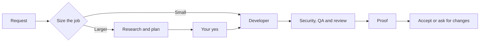
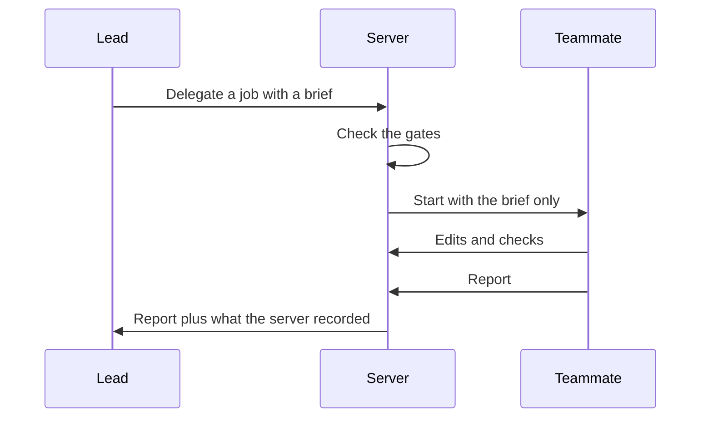

## The problem

AI can now build and fix software for someone who cannot read code.
The trouble is trust.
That person cannot tell whether "it works" is true, so they either believe the AI blindly or they do not use it.

I built AI Workspace around that gap. The goal is simple: the person should never have to take the AI's word for it.

## How a request flows

You describe what you need in plain language. The workspace sizes the job, plans it when it is big, builds it step by step, and shows proof before you accept anything.

## The AI orchestration

One AI does not do the whole job. An orchestrator leads a team of specialist roles, and each role has its own instructions, its own access, and optionally its own model.

| Role | What it does |
| --- | --- |
| Orchestrator | Talks to you, sizes the job, plans, and hands out work |
| Researcher | Looks up facts, with sources, before anyone builds |
| Business Analyst | Turns the request into requirements and a definition of done |
| Planner | Asks you what it needs and writes the PRD |
| Architect | Designs the approach and later checks the final code against it |
| Designer | Sets the visual direction and builds the interface |
| Developer | Writes and changes the code |
| Security | Audits the code before an app is started |
| QA Tester | Runs the checks and tries to break the work |
| Reviewer | Looks at the running screens as someone who did not build them |

### The lead looks and delegates, it does not build

The orchestrator can read files, plan, ask you questions, and delegate.
It is never even offered a tool that changes files or runs commands.
If it tries one anyway, the server refuses.
A one-line fix still goes to the Developer.

So the lead cannot quietly take over a job it was meant to hand off.

### Delegation is a brief and a report

The lead hands a job to a teammate with a role and a written brief. The teammate sees only that brief, not the whole conversation. It works in its own loop, and it ends with a report.

Each handoff shows up as a card in your thread, so you can see who was asked and what came back. Teammates cannot delegate further, and only the lead can finish the task.

Every role can use a different model. A role uses its own model when you set one, and your default otherwise.

### The server checks the report against what happened

A teammate's report is only what it says it did. So the server appends what it recorded itself: which files that role changed and which checks it ran. The lead weighs the claim against the facts.

### Size first, because teams are expensive

Every handoff costs time and tokens. The lead sizes the request before it hires anyone. A question gets an answer. A small change goes straight to the Developer.

Anything new, or anything risky, runs in order. Research comes first, then requirements, then the PRD. After that comes design, building in slices, a styling pass, and finally checks by Security, QA, the Architect, and the Reviewer.

### The server enforces the rules, not the prompt

Rules written in a prompt can be skipped. On a real run, the research step was skipped exactly that way. So the rules that matter live in code.

| Gate | What the server enforces |
| --- | --- |
| Plan approval | Nobody who builds can start until you say "Start building" on the PRD |
| Research first | The Researcher runs before the Planner, and again on the PRD's stack before anyone builds |
| Security | An app with code does not start until Security has reported on the latest changes |
| Architect | The task cannot finish until the Architect has checked the final code |
| Reviewer | When screens changed, the task cannot finish until someone else has looked at them running |
| Running app | A built page with no running app holds the finish |

Each gate has a limit of a few rounds. A reviewer that keeps finding things, or a check that cannot be satisfied, can never stop a task from ending.

### Keeping a long run alive

- **Shared budget.** The lead and every teammate draw from one budget of model turns and time. Each delegation also has its own smaller cap. Running out is a pause, and Continue picks up where the work stopped.
- **Stuck detection.** If several jobs in a row change nothing, run no check, and write no document, the lead is told it is stuck instead of looping.
- **Long conversations.** When the context window fills, the model writes its own summary. It keeps the request, the decisions, the files touched, the open problems, and the next step. A summary that fails is not retried forever.
- **One task per project.** Two agents never edit the same folder at the same time.

## Proof is computed, not claimed

The proof only counts checks the server ran itself after the last change. Anything the AI says it checked on its own is listed as claimed and never counts.

## Safety by access

A role that reads text from the web cannot write files or run commands, because that text comes from strangers. This limits what a hostile page can make the AI do.

Work runs in a throwaway container with no network except a controlled proxy. Every edit keeps what was there before, so Undo restores it.

## Connecting other AI apps

Other AI apps, such as ChatGPT, can connect and work in their own project. The workspace signs them in with its own OAuth server. The person switches individual abilities on or off, and every call is logged.

## Known limits

Whoever controls the Docker socket controls the host, so the docs recommend rootless Docker.
The sandbox does not cover disk quotas or the kernel that every container shares.
A team costs more time and tokens than a single agent, which is why the lead sizes a job first.

## What I took from it

A large part of the work was deciding what each role may touch, what counts as proof, and what the person always controls.

## Links

- Product: [workspace.masihawam.com](https://workspace.masihawam.com)
- Source: [github.com/farismnrr/agentic-ai-workspace](https://github.com/farismnrr/agentic-ai-workspace)
