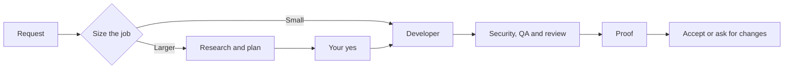
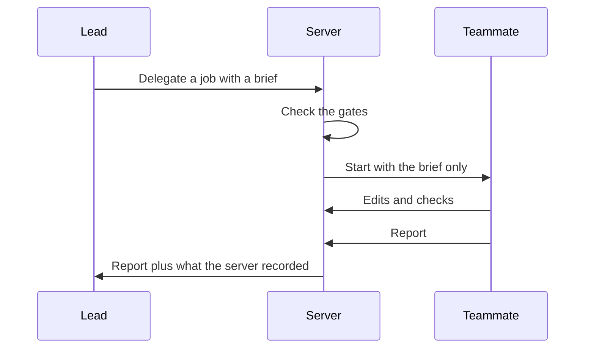

## The problem

AI can now build and fix software for someone who cannot read code. What that person cannot do is check the result.
When the AI says "it works", they either believe it or skip the tool.

I built AI Workspace so nobody has to take the AI's word for it. Every result comes with checks that the server ran itself.

## How a request flows

You describe what you need in plain language. The workspace sizes the job, plans it when it is big, builds it step by step, and shows proof before you accept anything.

## The team

Work is split across ten roles. An orchestrator leads, and each specialist has its own instructions, its own access, and optionally its own model.

| Role | What it does |
| --- | --- |
| Orchestrator | Talks to you, sizes the job, plans, and hands out work |
| Researcher | Looks up facts, with sources, before anyone builds |
| Business Analyst | Turns the request into requirements and a definition of done |
| Planner | Asks you what it needs and writes the PRD |
| Architect | Designs the approach and later checks the final code against it |
| Designer | Sets the visual direction and builds the interface |
| Developer | Writes and changes the code |
| Security | Audits the code before an app is started |
| QA Tester | Runs the checks and tries to break the work |
| Reviewer | Looks at the running screens as someone who did not build them |

## Why the lead cannot edit files

The orchestrator reads files, plans, asks you questions, and delegates. It is never offered a tool that edits files or runs commands, and the server rejects the call if it tries one.
Even a one-line fix goes to the Developer, so the role that decides is never the role that does the work.

## How a job is handed over

The lead gives a teammate a role and a written brief. The teammate sees only that brief, works in its own loop, and ends with a report.
Each handoff appears as a card in your thread, so you can see who was asked and what came back.
Teammates cannot hand work on to anyone else, and only the lead can finish the task.

## Checks the server runs itself

A teammate's report is only what it says it did.
So the server adds what it recorded on its own: which files that role changed and which checks it ran.
The lead weighs the claim against those facts.

The proof screen works the same way. It counts only checks the server ran after the last change. Anything the AI says it checked on its own is shown as claimed and never counts.

## Gates the server enforces

A rule that lives only in a prompt can be skipped. On a real run, the research step was skipped exactly that way, so the rules that matter are enforced in code.

| Gate | What the server enforces |
| --- | --- |
| Plan approval | Nobody who builds can start until you say "Start building" on the PRD |
| Research first | The Researcher runs before the Planner, and again on the PRD's stack before anyone builds |
| Security | An app with code does not start until Security has reported on the latest changes |
| Architect | The task cannot finish until the Architect has checked the final code |
| Reviewer | When screens changed, the task cannot finish until someone else has looked at them running |
| Running app | A built page with no running app holds the finish |

Each gate allows only a few rounds. A reviewer that keeps finding things cannot stop a task from ending.

## Sizing a job

Every handoff costs time and tokens, so the lead sizes a request before it brings in the team. A question gets an answer. A small change goes straight to the Developer.
Anything new or risky runs in order: research, requirements, the PRD, design, building in slices, a styling pass, and then checks by Security, QA, the Architect, and the Reviewer.

## Long runs

The lead and its teammates draw from one budget of model turns and time, and each handoff has a smaller cap of its own. Running out pauses the task, and Continue picks up where it stopped.
If several jobs in a row change nothing and run no check, the lead is told it is stuck instead of looping.
When the context window fills, the model writes its own summary of the request, the decisions, the files touched, the open problems, and the next step.
A project also runs one task at a time, so two agents never edit the same folder.

## Safety

A role that reads text from the web cannot write files or run commands, because that text comes from strangers.
Work runs in a throwaway container with no network except a controlled proxy, and every edit keeps what was there before, so Undo restores it.

## Connecting other AI apps

Other AI apps, such as ChatGPT, can connect and work in their own project. The workspace signs them in with its own OAuth server.
You switch individual abilities on or off, and every call is logged.

## Known limits

Whoever controls the Docker socket controls the host, so the docs recommend rootless Docker.
The sandbox does not cover disk quotas or the kernel that every container shares.
A team costs more time and tokens than a single agent, which is why the lead sizes a job first.

## What I Did

- Designed and developed Masih Awam Workspace end-to-end, covering frontend, backend, AI orchestration, and infrastructure.
- Built a multi-agent system with specialized roles for research, planning, design, development, security, testing, and code review.
- Implemented agent orchestration with configurable models, tool permissions, task delegation, and human approval workflows.
- Developed a task management system with live progress tracking, resumable sessions, file changes, and verification reports.
- Built isolated Docker environments for code execution, automated testing, browser previews, and application hosting.
- Integrated MCP and OAuth 2.1 to let external AI applications access workspace tools and projects with controlled permissions.
- Added GitHub integration, support for multiple AI providers, and automated CI/CD pipelines for building and deploying the platform.
- Packaged the Svelte frontend and Go backend into a single executable for simpler deployment.

## Links

- Product: [workspace.masihawam.com](https://workspace.masihawam.com)
- Source: [github.com/farismnrr/agentic-ai-workspace](https://github.com/farismnrr/agentic-ai-workspace)
