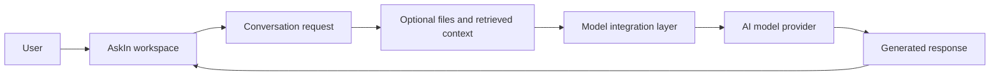

## What it is

AskIn is an AI chat app I worked on during Ruangguru Academy.
It lets a user pick a model, start a conversation, add files or other context, and get an answer, without knowing which service is behind it.

## How it works

The app is a customized version of an open-source chat interface (Open WebUI), with a Svelte frontend and a Python backend on FastAPI. I did not write the interface from scratch.

The backend sits between the web app and the models.
It exposes the APIs, handles authenticated requests, discovers the available models, and routes chat requests to Ollama-compatible or OpenAI-compatible endpoints, so the experience stays the same when the model changes.

It also has a retrieval step.
Files and knowledge sources can be processed into context, and relevant parts are attached to a conversation before the request reaches the model.
Requests that do not need context go through the same flow without it.

## What I worked on

My focus was the backend and the integration: understanding the architecture well enough to adapt it, run it, and reason about where the app ends and the AI services begin.
I also worked on how the app is presented, such as the new-chat screen and model selection.
Docker packaging lets the frontend and backend run as one application.

## Links

- Source: [github.com/farismnrr/askin](https://github.com/farismnrr/askin)
