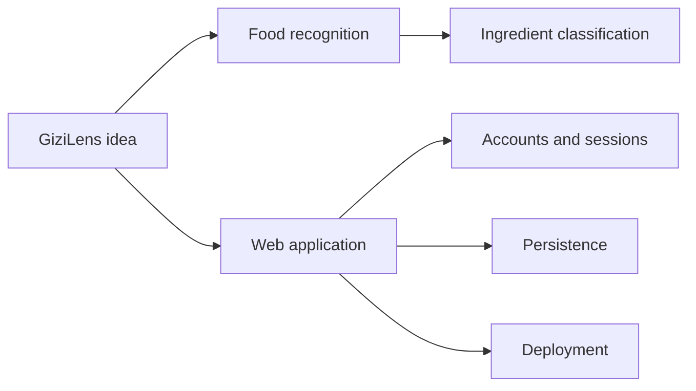

## What it was

GiziLens was a team capstone in the DBS Foundation program. The idea: a nutrition app that starts from something users already have, a photo of food or an ingredient.

The team split in two.
One side built the food-image recognition, and the other built the web application around it: accounts, sessions, data, and deployment.
They lived in separate repositories and were not fully connected end to end, so I describe each part for what it is.

## What another team member built

The classifier recognizes 32 food and ingredient classes using TensorFlow and EfficientNetV2L. The repository history attributes that work to another team member, not to me.

## What I built

Built the web application and runtime with a Nuxt frontend and a Bun and TypeScript backend on Hapi.

- Implemented registration for different roles, login, user reading and updates, logout, account deletion and restore, and token refresh. Protected routes with JWTs and persisted sessions so the server could validate and revoke access.
- Set up PostgreSQL for users and sessions and Redis as a fast-access layer, with both behind repository layers instead of being called from every handler.
- Containerised the frontend and backend separately, composed them with PostgreSQL, Redis, and Nginx on one Docker network, and set up HTTPS and update scripts.

The frontend covers registration, login, token refresh, logout, and a dashboard. Not included: an image-upload-to-classification flow.

## Links

- Source: [GiziLens repositories](https://github.com/orgs/Group-CC25-CF047/repositories)
