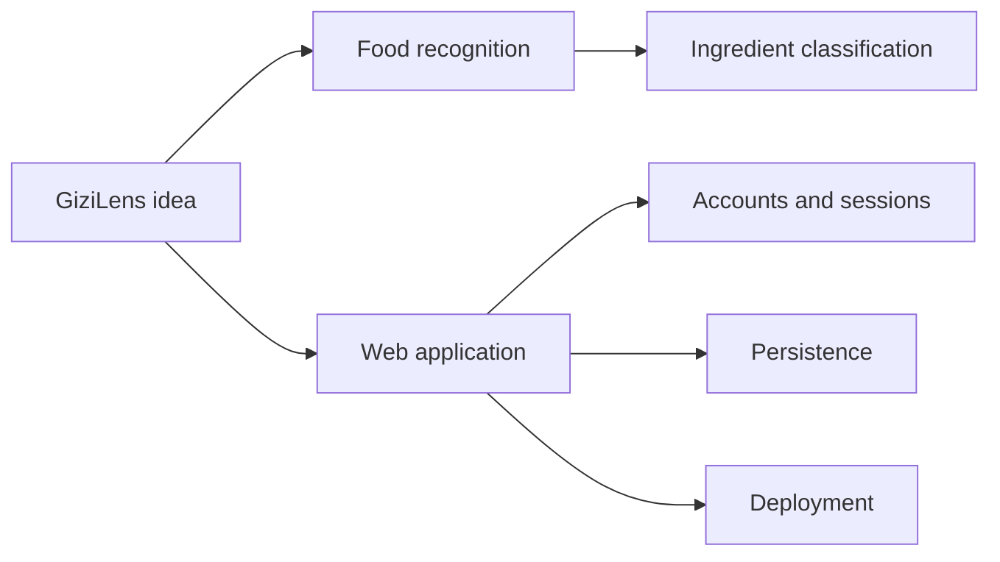

## What it was

GiziLens was a team capstone in the DBS Foundation program. The idea: a nutrition app that starts from something users already have, a photo of food or an ingredient.

The team split in two.
One side built the food-image recognition, and the other built the web application around it: accounts, sessions, data, and deployment.
They lived in separate repositories and were not fully connected end to end, so I describe each part for what it is.

## What another team member built

The classifier recognizes 32 food and ingredient classes using TensorFlow and EfficientNetV2L. The repository history attributes that work to another team member, not to me.

## What I built

I built the web application and its runtime, in a Nuxt frontend and a Bun and TypeScript backend on Hapi.

- **Authentication as a full lifecycle.** Registration for different roles, login, reading and updating the user, logout, account deletion and restore, and token refresh. JWTs protect routes, and persisted sessions let the server validate and revoke access.
- **Storage.** PostgreSQL for users and sessions, Redis as a fast-access layer, both behind repository layers instead of being called from every handler.
- **Running as a service.** Separate container builds for frontend and backend, composed with PostgreSQL, Redis, and Nginx on one Docker network, plus HTTPS setup and update scripts.
- **The logo.** I designed the original vector identity: a G, a circular lens or plate, and a leaf, with variants and usage rules.

The frontend covers registration, login, token refresh, logout, and a dashboard. It does not include the image-upload-to-classification flow, so I do not describe it as done.

## Links

- Source: [GiziLens repositories](https://github.com/orgs/Group-CC25-CF047/repositories)
