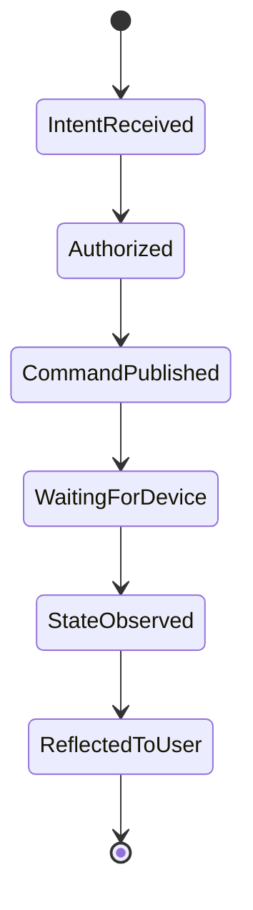

## What it is

IoTNet manages devices, users, automations, and telemetry in one place. I built it alone. It sits between people and connected hardware, so users work with devices and rules instead of broker topics and raw messages.

## A command is not a result

A user asks for an outcome. The platform checks who is asking and which device it targets, publishes the command, and then waits for the device to report its state before it shows the change.

HTTP serves the people using the app. MQTT carries the device traffic, because messages arrive asynchronously and connections come and go. The backend sits between the two.

## Ownership and automation

Every device belongs to a scope such as a tenant, an organization, or a site. Before a command goes out, the platform checks what the device can do and whether the user may ask for it.

Automations use one small model: an event, a condition, a decision, and an action.
A temperature reading can be the event, occupancy and thresholds the conditions, and the matching rule decides whether to act.
The same model covers alerts, schedules, and environment control.

## Stack

Nuxt and Vue on the front end. A TypeScript backend on Hapi and Bun, PostgreSQL for application data, MQTT through EMQX for devices, and OpenTelemetry for tracing.

## Links

- Product: [i-ot.net](https://i-ot.net/)
