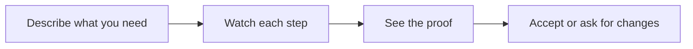

## Why I built it

AI can now build and fix software for someone who cannot read code. The problem is trust. That person cannot tell whether "it works" is true, so they either believe the AI blindly or they do not use it.

Masih Awam AI Code is my answer to that gap. The point is not a smarter AI. The point is that the person never has to take the AI's word for it.

## How it works

You write what you need in plain language, for example "my sign-in page doesn't work anymore." The AI plans the work and shows every step as it goes. Nothing is final until you accept it.

## Trust is the product

Three rules shape everything else.

- **Ask before changing.** Reading is automatic. Changing files or running commands waits for a yes.
- **Proof comes from checks, not claims.** The proof is built only from checks the app ran itself after the last change. Anything the AI says on its own is marked as claimed.
- **Everything can be undone.** Each change keeps what was there before.

AI work runs in an isolated environment, so a mistake stays inside the person's own project and cannot touch anything else.

## Open to other AI apps

Other AI apps, such as ChatGPT, can connect and work in their own project inside the same workspace. The person decides which abilities each connected app gets, and every call is logged.

## What I took from it

Most of the engineering effort went into boundaries, not into the AI. Deciding what the AI may touch, what counts as proof, and what the person always controls mattered more than any single feature.

## Links

- Source: [github.com/farismnrr/agentic-ai-workspace](https://github.com/farismnrr/agentic-ai-workspace)
