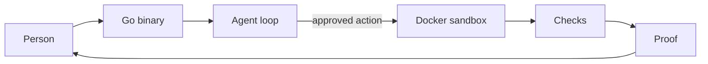

## The problem

An AI can build an app for someone who cannot read code, but that person has no way to tell whether the result works.
The workspace is built around that gap.
You describe what you need, watch each step, and accept only work that a check has proven.

## One binary, one port

The backend is a single Go binary using Fiber v3.
The Svelte 5 web app is compiled once and embedded in it, so there is one process to deploy and one port to configure.
Data lives in SQLite through a pure-Go driver, which keeps the binary static, and schema changes only go through numbered, checksummed migration files.

Each feature is a module with `domain`, `application`, and `adapter` layers, and dependencies point inward. A domain rule never knows which HTTP framework or database sits underneath. Source files stay under 200 lines, enforced by the build.

## Every run gets a throwaway container

Tasks, commands, and the web apps the AI starts run in one short-lived Docker container per run, started through the Docker socket.

| Limit | How |
| --- | --- |
| Files | Only that person's project folder is visible |
| Network | None, except package registries through a proxy |
| System | Read-only root, no extra privileges, memory, CPU, and process limits |
| Capacity | `MAX_SANDBOXES` runs at once; a run stops if its folder passes 2 GiB |

## Proof instead of claims

Reading is automatic.
Changing files or running commands waits for the person's approval, unless they turned on Skip approvals.
The Proof tab is built only from checks the app ran itself after the last change.
Anything the AI asserts on its own is marked "claimed".

A project's checks live in `.workspace/tasks.json`, and the AI's tools can never read or write that file. Edits save the old content first, so Undo restores it. Runs are capped at 40 model turns and 15 minutes.

## Connecting other AI apps

The binary hosts its own sign-in and an OAuth 2.1 server, so ChatGPT and other MCP clients can connect to the `coding` endpoint without an extra service.
Each connected app gets its own project, and every call resolves to one person's files.
Tokens are stored hashed and tied to one space, and a replayed code or refresh token revokes the whole connection.
Each tool has a switch the person controls, and every call is logged.

## Known limits

The Docker socket gives whoever controls it control of the host, so the docs recommend rootless Docker.
Hard disk quotas and the shared host kernel are not covered by the sandbox.
If Docker is down, checks fail with a plain reason and nothing else breaks.

## Links

- Source: [github.com/farismnrr/agentic-ai-workspace](https://github.com/farismnrr/agentic-ai-workspace)
