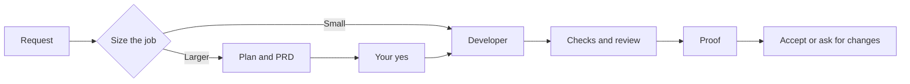

## The problem

AI can now build and fix software for someone who cannot read code.
The trouble is trust.
That person cannot tell whether "it works" is true, so they either believe the AI blindly or they do not use it.

I built Masih Awam AI Code around that gap. The goal is not a smarter AI. The goal is that the person never has to take the AI's word for it.

## How a request flows

You describe what you need in plain language. The workspace sizes the job, plans it when it is big, builds it step by step, and shows proof before you accept anything.

## Decisions that shaped it

**The lead never changes anything itself.** The orchestrator can look, plan, ask you questions, and hand out jobs.
It cannot edit a file or run a command, even for a one-line fix.
I rejected a single agent that does everything, because planning and doing in the same place hides who decided what.

**Small jobs skip the team.** Every handoff costs time and tokens.
The lead sizes the request first.
A typo goes straight to the Developer.
A new app goes through research, requirements, a plan, design, building in slices, and review.

**The server enforces the rules, not the prompt.** A prompt can be ignored, so the rules that matter live in code.
While you are still planning, the server refuses any teammate who tries to build.
An app with code in it does not start until the Security role has reported on the latest changes.
The review rounds are capped, so a reviewer that keeps finding things cannot block an app forever.

**Proof is computed, not claimed.** The proof only counts checks the server ran itself after the last change. Anything the AI says it checked on its own is listed as claimed and never counts.

**Roles get only the access they need.** A role that reads text from the web cannot write files or run commands, because that text comes from strangers.
This limits what a hostile web page can make the AI do.

**Work runs in a throwaway container.** Each run gets its own isolated container, limited to the person's project folder, with no network except through a controlled proxy.

**Every change can be undone.** Each edit keeps what was there before, so Undo restores it.

## Connecting other AI apps

Other AI apps, such as ChatGPT, can connect and work in their own project.
The workspace signs them in with its own OAuth server.
Each connected app gets its own project, the person switches individual abilities on or off, and every call is logged.

## Known limits

Whoever controls the Docker socket controls the host, so the docs recommend rootless Docker.
The sandbox does not cover disk quotas or the kernel that every container shares.
A team costs more time and tokens than a single agent, which is why the lead sizes a job before it hires anyone.

## What I took from it

Most of the effort went into boundaries, not into the AI. Deciding what the AI may touch, what counts as proof, and what the person always controls mattered more than any single feature.

## Links

- Source: [github.com/farismnrr/agentic-ai-workspace](https://github.com/farismnrr/agentic-ai-workspace)
