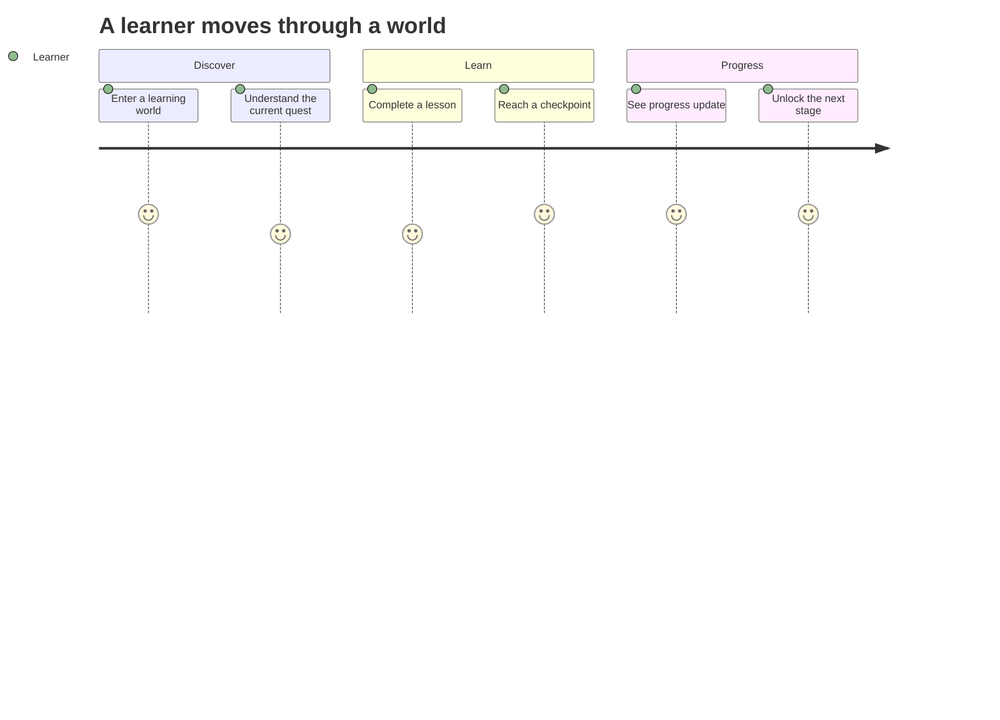

## What it is

A learning platform where courses become worlds, quests, and lessons. A normal course list tells you what exists. This one tries to tell the learner what to do next.

The learning structure stays familiar: courses, modules, lessons. The learner moves through worlds, quests, and checkpoints instead of a flat catalog.

## How it is built

Progress is simple on purpose: completed lessons divided by total lessons, at the lesson, quest, world, and overall level.
The story gives context for why the next lesson matters, but it never decides what counts as complete.

The product keeps three layers apart.
The experience layer holds worlds, quests, and scenes.
The learning domain holds courses, modules, lessons, and enrollment.
The progress state records what the learner actually finished.
Story and presentation can change without touching completion.

Pages are rendered according to who owns their data. Public course pages are prerendered, a learner's dashboard is rendered privately on the server, and interactive state stays in the browser.

## Stack

A Rust backend with Axum and PostgreSQL, a lightweight browser interface, and observability through OpenTelemetry, Prometheus, Loki, Tempo, and Grafana.
