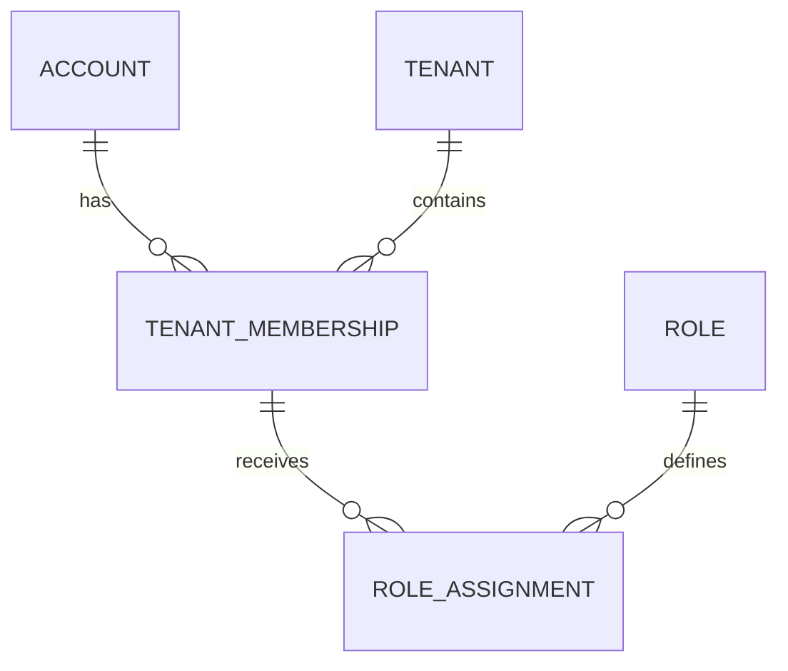
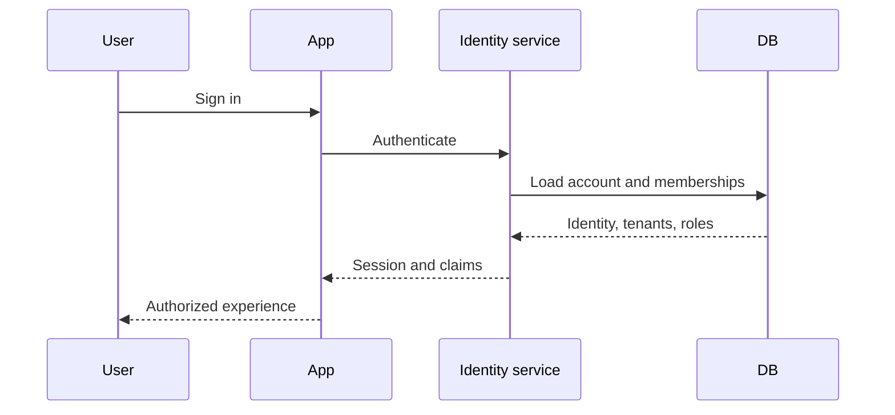

## What it is

A login and identity service that several applications can share. I built it alone.

One person has one account, and that account can belong to several tenants with a different role in each.
Someone can be an admin in one organization and a normal user in another, with the same password and the same session logic everywhere.

## Why it is separate

When every application keeps its own users table, the same person ends up with several accounts and several role schemes, and each application handles sessions a little differently.
One service gives all of them the same answers.

## How sign-in and permissions work

Signing in proves who you are and loads your memberships. What you may do depends on the tenant you act in.

Every protected action follows the same chain: identity, tenant, membership, role, permission, then allow or deny. A valid login alone never grants access.

## Tradeoffs

Applications now depend on the identity service being available. Tenant boundaries have to stay explicit everywhere, because accounts are shared. A rich role model covers more cases, but it needs discipline to stay readable.

## Stack

Rust with Actix-web, PostgreSQL for identity data, RocksDB for local caching, JWT sessions, Argon2 for password hashing, and Docker for packaging.

## Links

- Source: [github.com/farismnrr/Multitenant-User-Management-Service](https://github.com/farismnrr/Multitenant-User-Management-Service)
