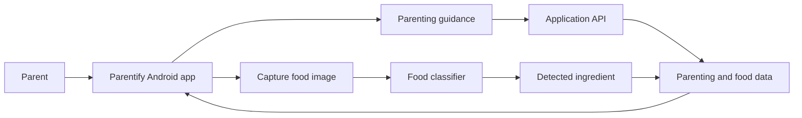

## What it was

Parentify was our Bangkit Academy capstone: an Android app that puts parenting guidance and camera-based food recognition in one place. A parent can read articles, or photograph an ingredient and get information about it.

## The three tracks

- **Mobile Development** built the Android client in Kotlin, with camera capture and local storage.
- **Cloud Computing** built the backend API, authentication, application data, and the contract the app depends on.
- **Machine Learning** trained a convolutional network to classify 36 food-ingredient categories and exported it for mobile use. The best validation accuracy in the recorded experiment was about 93.7%. That is a training result, not a promise for real camera input.

## What I built

I was on the Cloud Computing track.
I built the backend the Android app talks to: a Node.js service on Express for authentication, parenting articles, and food information, with MySQL for the data.
Sign-in used JWTs and bcrypt password hashing, and requests were validated with Joi.

The backend was prepared for Google Cloud with deployment notes and an update script, and Postman documentation helped the three teams test the API contract.
That contract mattered most: each team could work on its own only because names, payloads, and data relationships matched.

## Links

- [Cloud Computing](https://github.com/Parentify/Parentify-Cloud-Computing): backend API, data, and cloud setup.
- [Mobile Development](https://github.com/Parentify/Parentify-Mobile-Development): the Android app.
- [Machine Learning](https://github.com/Parentify/Parentify-Machine-Learning): dataset workflow and model training.
