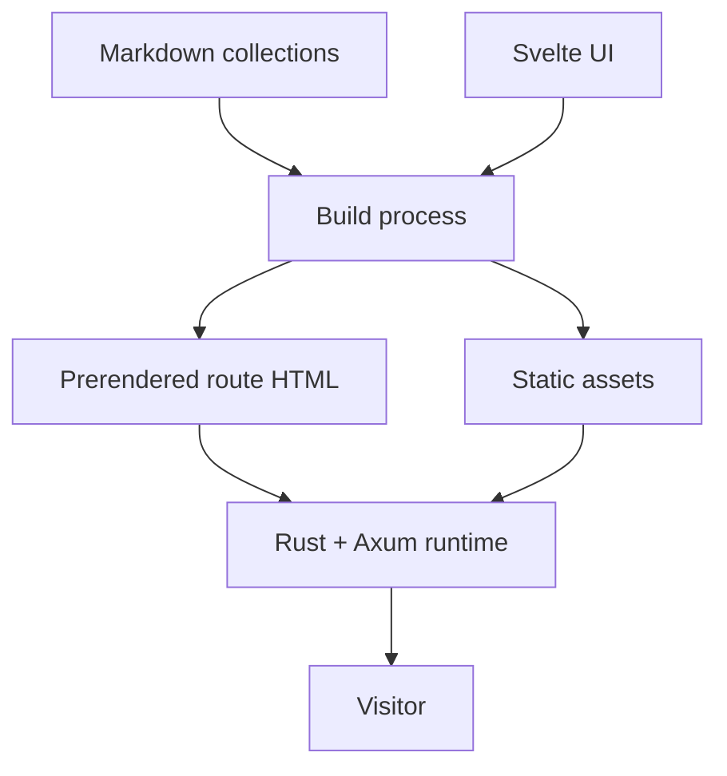

## What it is

This site.
Projects, experience, certifications, and blog posts are Markdown files, and one content collection drives the project cards, project modal, and homepage selections.
Adding a project means writing a file, not editing a component.

## How it is built

Public routes are prerendered at build time, so crawlers and browsers get real HTML right away.
Svelte then hydrates the page for client-side navigation.
A small Rust and Axum server embeds the generated pages and assets for production.

The site keeps ordinary web behavior: normal link handling, lazy route loading, hash links that wait for the page before scrolling, separate desktop and mobile navigation, and a skip link to the main content.

## Tradeoffs

Markdown is comfortable for me and works well with Git history, but it is harder for non-technical editors.
Content changes are versioned and reviewable, but they still need a build and a deployment.
Every project can tell a different story, so a writing check in the build keeps the copy consistent.

## Stack

Svelte 5 and Vite, Markdown with Mermaid for diagrams, prerendering at build time, Rust with Axum in production, and GitHub Actions for validation, build, and deployment.

## What I Did

- Developed a personal portfolio website end-to-end using Svelte 5 and Rust, covering frontend, backend, and infrastructure.
- Built a Markdown-driven content system to manage projects, work experience, certifications, and blog posts.
- Implemented prerendered pages, client-side navigation, responsive layouts, and SEO optimization.
- Developed AI-powered portfolio retrieval using PostgreSQL, pgvector, and full-text search.
- Built an AI-assisted job matching feature that compares job requirements against portfolio evidence and generates PDF reports.
- Implemented automated CI/CD pipelines, cross-platform Docker builds, and deployment to an ARM64 Orange Pi server.

## Links

- Site: [farismnrr.com](https://farismnrr.com)
- Source: [github.com/farismnrr/portofolio](https://github.com/farismnrr/portofolio)
