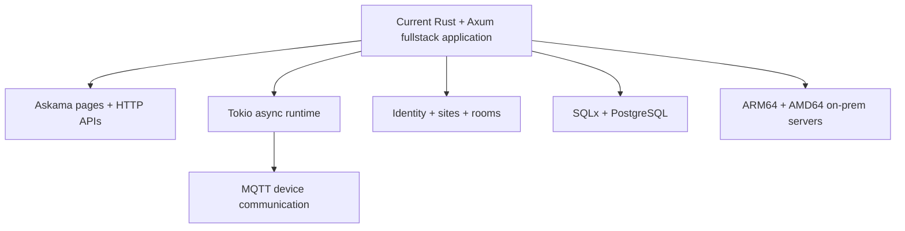
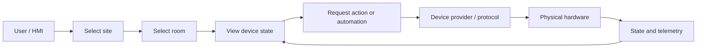
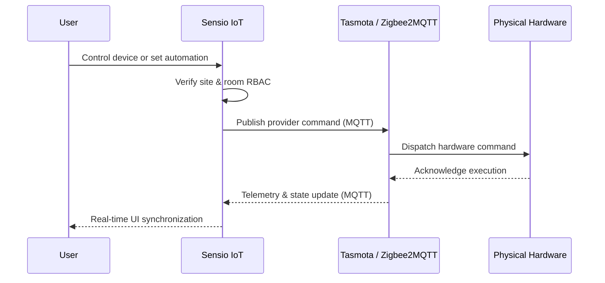

## A smart-space platform that runs beside its devices

**Sensio IoT is now a Rust and Axum fullstack application built for on-premises Linux servers.** It brings identity, site and room access, device control, and live state into a local runtime that can fit smaller ARM64 machines.

The interface starts with the spaces people manage: the lights in a meeting room, a sensor in an office, or the devices an operator is allowed to control. MQTT topics and hardware addresses stay behind that room model.

Getting here required a change in architecture. The product began with a SaaS direction, but client delivery moved it toward servers installed beside the physical devices. That shift changed what I needed from the application runtime.

## The first architecture served a different target

The earlier version paired a React HMI with a NestJS backend. For the original SaaS direction, NestJS was a practical choice: modules, controllers, services, and dependency injection gave complex application logic clear boundaries while keeping feature development fast.

I worked on backend and fullstack features around room state, telemetry, real-time updates, and a room-scoped LangGraph assistant. REST, WebSockets, and SSE connected the interface to changing device state; PostgreSQL and TimescaleDB stored application data and telemetry.

Those product ideas survived the rewrite. What changed was the machine expected to run them.

## When the server moved into the client's building

Each client installation became its own operating environment, with local networking, hardware integrations, configuration, and upgrades. The target included ARM64 single-board computers such as Orange Pi and Raspberry Pi, alongside other Linux edge hosts.

An application footprint that was manageable on a larger SaaS server became a meaningful cost on these machines. In the deployments I observed, the React and NestJS frontend and backend used approximately **800 MB of RAM**.

I needed to keep the fullstack control surface and real-time device communication while leaving more room for the operating system and supporting services. That became the reason to rebuild the runtime in Rust.

## Why Rust and Axum fit the new workload

The current service uses **Axum for HTTP APIs, Askama for rendered pages, SQLx for PostgreSQL access, and Tokio for asynchronous execution**. The frontend is delivered by the same Rust application, so the rewrite covers the fullstack application rather than only replacing its API server.

Memory was one part of the decision. The other was the shape of IoT traffic: device messages, command responses, browser requests, and live updates can arrive together. Much of that work waits on network or database I/O.

Tokio lets asynchronous tasks yield while waiting for I/O, allowing other ready tasks to continue. Its multithreaded scheduler can also execute tasks across runtime workers. That concurrency model fits a service handling dozens of connected devices while keeping the control interface responsive.

Rust also gives me control over allocation and resource lifetimes without a garbage-collected application runtime. Together with Tokio, that makes it a better fit for this deployment target: a small local server doing many overlapping I/O operations.

The benefit depends on implementation. Blocking work still needs to stay off asynchronous workers, and broker, network, and device delays still contribute to command latency. Keeping those tasks non-blocking helps limit application-side waiting when device traffic and user requests overlap.

## What changed in the running application

The Rust and Axum fullstack deployment used approximately **50 MB of RAM** while handling real-time communication with dozens of IoT devices, compared with approximately **800 MB** for the earlier React and NestJS application.

Both measurements cover the application frontend and backend. They exclude the database, MQTT broker, and other supporting services, and reflect observed deployments.

The trade-off is more deliberate systems work in exchange for a smaller runtime and tighter control over concurrent execution.

NestJS had helped me organize and implement the original product quickly. Rust now lets me carry those application boundaries into a runtime suited to the hardware clients actually use.



## Keeping physical scope at the center

The runtime changed, but the interaction still follows the same physical hierarchy. A user enters a site, selects a room, sees its devices, and requests an action within their permissions.



Providers translate that action into device-specific messages. Incoming state returns to the same room model, keeping the interface consistent as integrations evolve.

## Identity follows physical scope

The platform makes physical scope an integral part of authorization.

Users do not receive one global role that automatically applies everywhere. Site membership is the role boundary, and room access is evaluated through that site relationship. Permission to operate one office never grants access to another site.

Authentication is designed for an on-premises control surface: provisioned users sign in, short-lived access tokens pair with rotating refresh tokens, and browser sessions keep security credentials isolated from client-side scripts.

The result is a strict conceptual chain:

```text
identity
→ site membership
→ room scope
→ device action
```

## Tasmota and Zigbee behind one room model

The device communication layer is separated from the site and room domain model.

The platform manages two primary hardware integration pipelines:

1. **Tasmota-flashed smart devices and power monitoring**: smart plugs, energy meters, relays, and power strips running Tasmota publish telemetry and state through MQTT. The ingestion path reads power metrics and relay state. Commands go back through provider-specific topics without depending on an external cloud service.
2. **Zigbee2MQTT environmental and presence sensors**: Zigbee coordinators feed temperature, humidity, illuminance, motion, and door/window state into the same room-oriented model.

In the Rust implementation, those integrations sit behind mapping, adapter, repository, listener, service, and HTTP boundaries. Incoming messages are normalized into room-scoped state; outgoing actions are translated back into provider-specific payloads.



That boundary is where broker reconnects, protocol quirks, and message retries belong. Keeping them there prevents the UI and room model from having to understand every hardware-specific detail.

## On-prem is part of the product

For a smart-space system, deployment location affects both latency and reliability.

Lighting, room controls, telemetry, and local automation should keep working without depending on a distant cloud round-trip. Sensio IoT therefore makes on-premises deployment part of the product.

The Rust service is packaged as a multi-architecture Docker image for AMD64 and ARM64. It runs on Linux edge hardware, including NVIDIA Jetson devices and single-board computers.

OpenTelemetry, Prometheus metrics, structured logs, and container health checks help trace what happened when a broker, device, or local service stops behaving as expected.

## Diagnosing failures across software and hardware boundaries

A connected-device failure can surface in several places at once: the user-facing state, the application service, the MQTT broker, a provider adapter, or the physical device itself. Treating every symptom as an HTTP problem would hide the boundary that actually failed.

Within the software side of the product team, I use OpenTelemetry, Prometheus, structured logs, health checks, and device telemetry to narrow failures across the edge runtime.

Broker reconnects and message retries stay inside the integration boundary. Room-scoped application state remains separate from provider-specific transport behavior.

Observability supports this production diagnosis, while dedicated network tooling remains a separate capability. I first identify whether the failure is application state, authorization, broker connectivity, protocol translation, or hardware state, then follow the evidence at that boundary.

## Ownership inside a cross-functional team

Sensio IoT is a cross-functional product. My role has substantial ownership of the software platform, but the complete production system depends on work across software, physical IoT, infrastructure, security, and UI/UX.

Within that team, I own major backend and systems work around identity, room state, authorization, device integration, telemetry, protocol adapters, edge runtime behavior, and the Rust rewrite.

The IoT team handles physical installation and device provisioning collaboratively with the software side. I keep that hardware work separate from my own software ownership.

I also work with infrastructure and security engineers around the on-premises runtime, server access, deployment, and operational constraints.

UI/UX designers provide the visual and interaction direction for the human-facing control surface. My engineering responsibility is to connect that design to live room and device state within the constraints of the actual platform.

The production deployments span client-owned residential and office environments. That is evidence of client delivery in different operating environments, but I do not present it as proof of delivery across multiple commercial industries.

## The boundary that mattered most

The rewrite taught me to choose the runtime around the deployment and workload. The original SaaS direction rewarded fast development and structured application code; local ARM64 delivery made memory efficiency and concurrent device communication central to the design.

The harder question is how to keep **identity, physical scope, device state, protocol translation, and local operations** consistent while the system evolves. Once those boundaries are clear, individual device integrations become much easier to reason about.

## Links

- Sensio IoT: [iot.sensio.id](https://iot.sensio.id)
- Sensio Platform: [sensio.id](https://sensio.id)
