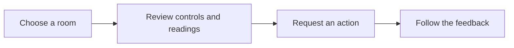

## What it is

Sensio IoT lets people control a room: lights, temperature, and equipment, with sensor readings and automation in one view. A team builds it across application engineering, device integration, infrastructure, security, and UI/UX.

## What I worked on

I build the backend side: commands, device-state feedback, and permissions.

- **Request and result are separate.** Sending a command is not the same as the device changing, so the app keeps the requested action apart from the state the device reports, and the interface shows what actually happened.
- **Clear feedback when a device is unavailable.** An interruption produces an understandable message instead of an action that looks finished.
- **Permissions on controls.** Users see which actions they may take, and get a useful reason when one cannot be completed.

I also test, troubleshoot with the device engineers, and work with the infrastructure and security engineers on releases.

## Links

- Product: [sensio.id](https://sensio.id)
