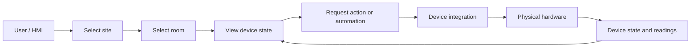
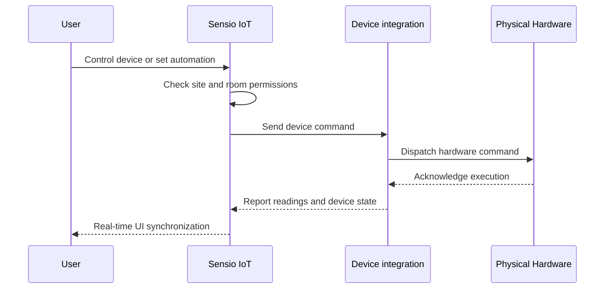
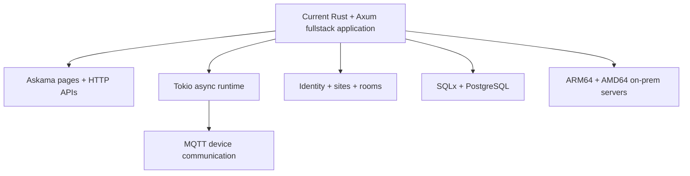

## Rooms, not protocols

People managing a room do not think in broker topics, hardware addresses, or database identifiers.

They think in physical language: *the lights in this meeting room, the sensor in that office, the devices this operator is allowed to control.*

**Sensio IoT** is built around translating those real-world boundaries into software boundaries.

The product has evolved through more than one implementation, but the underlying idea has stayed consistent: organize control around **sites and rooms**, keep device protocols behind an integration layer, and make local hardware state understandable from a human-facing interface.

## From room selection to live device control

A user first enters the physical scope they are responsible for, then works with the devices and automation inside that scope.



That hierarchy matters more than any particular protocol. The same product-level action can eventually be translated to different providers without making the user learn how each device communicates.

## Identity follows physical scope

The platform makes physical scope an integral part of authorization.

Users do not receive one global role that automatically applies everywhere. Site membership is the role boundary, and room access is evaluated through that site relationship. Permission to operate one office never grants access to another site.

An operator can work within the sites and rooms assigned to them. The application checks that scope before allowing an action to reach a device.

The result is a strict conceptual chain:

```text
identity
→ site membership
→ room scope
→ device action
```

## Connecting devices to the room model

The device communication layer is separated from the site and room domain model.

The room interface brings together controls such as lights, relays, and smart plugs, alongside readings such as temperature, humidity, motion, and power usage.

A user can request an action and follow the reported device state in the same room view. Different device families fit that shared flow through their own integrations.



The application translates between the room view and the connected devices, so users can follow one control flow across different kinds of hardware.

## Rebuilding the runtime for on-premises ARM64 servers

The product started with a SaaS direction, where a centrally managed application could run on a larger server. Delivery later shifted toward a local server installed in each client environment.

The original React HMI and NestJS backend suited the SaaS direction. NestJS modules, controllers, services, and dependency injection gave complex application logic clear boundaries while keeping feature development fast.

I worked on backend and fullstack features around room state, telemetry, real-time updates, and a room-scoped LangGraph assistant. REST, WebSockets, and SSE connected the interface to changing device state; PostgreSQL and TimescaleDB stored application data and telemetry.

Those product ideas survived the rewrite. What changed was the machine expected to run them.

Each client installation became its own operating environment, with local networking, hardware integrations, configuration, and upgrades. The target included ARM64 single-board computers such as Orange Pi and Raspberry Pi, alongside other Linux edge hosts.

An application footprint that was manageable on a larger SaaS server became a meaningful cost on these machines. In the deployments I observed, the React and NestJS frontend and backend used approximately **800 MB of RAM**.

I needed to keep the fullstack control surface and real-time device communication while leaving more room for the operating system and supporting services. That became the reason to rebuild the runtime in Rust.

The current service uses **Axum for HTTP APIs, Askama for rendered pages, SQLx for PostgreSQL access, and Tokio for asynchronous execution**. The frontend is delivered by the same Rust application, so the rewrite covers the fullstack application rather than only replacing its API server.

Memory was one part of the decision. The other was the shape of IoT traffic: device messages, command responses, browser requests, and live updates can arrive together. Much of that work waits on network or database I/O.

Tokio lets asynchronous tasks yield while waiting for I/O, allowing other ready tasks to continue. Its multithreaded scheduler can also execute tasks across runtime workers. That concurrency model fits a service handling dozens of connected devices while keeping the control interface responsive.

Rust also gives me control over allocation and resource lifetimes without a garbage-collected application runtime. Together with Tokio, that makes it a better fit for this deployment target: a small local server doing many overlapping I/O operations.

The benefit depends on implementation. Blocking work still needs to stay off asynchronous workers, and broker, network, and device delays still contribute to command latency. Keeping those tasks non-blocking helps limit application-side waiting when device traffic and user requests overlap.

The Rust and Axum fullstack deployment used approximately **50 MB of RAM** while handling real-time communication with dozens of IoT devices, compared with approximately **800 MB** for the earlier React and NestJS application.

Both measurements cover the application frontend and backend. They exclude the database, MQTT broker, and other supporting services, and reflect observed deployments.

The trade-off is more deliberate systems work in exchange for a smaller runtime and tighter control over concurrent execution.

NestJS had helped me organize and implement the original product quickly. Rust now lets me carry those application boundaries into a runtime suited to the hardware clients actually use.



## Keeping control reliable when connections fail

A broker connection can drop while telemetry is arriving, or a device can become unreachable while a user is viewing its room. A requested command and a confirmed change in physical state are separate events.

A connected-device failure can surface in several places at once: the user-facing state, the application service, the MQTT broker, a provider adapter, or the physical device itself. Treating every symptom as an HTTP problem would hide the boundary that actually failed.

Within the software side of the product team, I use OpenTelemetry, Prometheus, structured logs, health checks, and device telemetry to narrow failures across the edge runtime.

Broker reconnects and message retries stay inside the integration boundary. Room-scoped application state remains separate from provider-specific transport behavior.

Observability supports this production diagnosis, while dedicated network tooling remains a separate capability. I first identify whether the failure is application state, authorization, broker connectivity, protocol translation, or hardware state, then follow the evidence at that boundary.

## Operating inside client environments

Sensio IoT is delivered into client-owned environments and runs on-premises alongside the spaces and hardware it controls. Each deployment is its own operating environment instead of one shared SaaS instance.

That changes the engineering boundary. Deployment, configuration, observability, hardware connectivity, and upgrades have to work inside each client environment instead of assuming one centrally managed cloud runtime.

The product team treats that client delivery model as part of the product itself. The application has to remain understandable and operable after it leaves a development machine, including on edge hardware where local network conditions and device integrations are part of normal production behavior.

For a smart-space system, deployment location affects both latency and reliability.

Lighting, room controls, telemetry, and local automation should keep working without depending on a distant cloud round-trip. Sensio IoT therefore makes on-premises deployment part of the product.

The platform manages two primary hardware integration pipelines:

1. **Tasmota-flashed smart devices and power monitoring**: smart plugs, energy meters, relays, and power strips running Tasmota publish telemetry and state through MQTT. The ingestion path reads power metrics and relay state. Commands go back through provider-specific topics without depending on an external cloud service.
2. **Zigbee2MQTT environmental and presence sensors**: Zigbee coordinators feed temperature, humidity, illuminance, motion, and door/window state into the same room-oriented model.

In the Rust implementation, those integrations sit behind mapping, adapter, repository, listener, service, and HTTP boundaries. Incoming messages are normalized into room-scoped state; outgoing actions are translated back into provider-specific payloads.

Authentication is designed for an on-premises control surface: provisioned users sign in, short-lived access tokens pair with rotating refresh tokens, and browser sessions keep security credentials isolated from client-side scripts.

The Rust service is packaged as a multi-architecture Docker image for AMD64 and ARM64. It runs on Linux edge hardware, including NVIDIA Jetson devices and single-board computers.

OpenTelemetry, Prometheus metrics, structured logs, and container health checks help trace what happened when a broker, device, or local service stops behaving as expected.

## Ownership inside a cross-functional team

Sensio IoT is a cross-functional product. My role has substantial ownership of the software platform, but the complete production system depends on work across software, physical IoT, infrastructure, security, and UI/UX.

Within that team, I own major backend and systems work around identity, room state, authorization, device integration, telemetry, protocol adapters, edge runtime behavior, and the Rust rewrite.

The IoT team handles physical installation and device provisioning collaboratively with the software side. I keep that hardware work separate from my own software ownership.

I also work with infrastructure and security engineers around the on-premises runtime, server access, deployment, and operational constraints.

UI/UX designers provide the visual and interaction direction for the human-facing control surface. My engineering responsibility is to connect that design to live room and device state within the constraints of the actual platform.

The production deployments span client-owned residential and office environments. That is evidence of client delivery in different operating environments, but I do not present it as proof of delivery across multiple commercial industries.

## What I worked on

Within that team, my work has covered both generations of the product.

In the earlier React + NestJS version, I worked on backend and fullstack pieces around room state, telemetry, real-time updates, and the LangGraph control flow.

In the Rust rewrite, I moved more of that software responsibility into a smaller edge-oriented service built with Axum and SQLx.

A large part of my backend work is authorization. Site membership and room scope have to be checked before a command reaches a physical device, so I built the access-control path around those boundaries instead of treating permissions as a UI concern.

I also work on the software side of the hardware integration boundary: MQTT consumers, Tasmota telemetry and relay state, Zigbee2MQTT adapters, device discovery, and command dispatch.

Those integrations are translated into one room/device model that the rest of the product can use without knowing the underlying protocol details.

My deployment contribution includes packaging the service for AMD64 and ARM64, running it on local edge hardware, and using OpenTelemetry, Prometheus, and logs to investigate issues that only show up when software is sitting next to real devices and imperfect networks.

## The boundary that mattered most

The recurring lesson in Sensio IoT is that sending a command to a broker is the straightforward part of connected-device software.

The harder question is how to keep **identity, physical scope, device state, protocol translation, and local operations** consistent while the system evolves. Once those boundaries are clear, individual device integrations become much easier to reason about.

## Links

- Sensio IoT: [iot.sensio.id](https://iot.sensio.id)
- Sensio Platform: [sensio.id](https://sensio.id)
