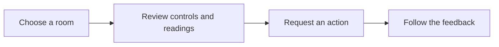

## A room people can manage

People managing a room think about its lights, temperature, and equipment. They need an understandable view of the space and a practical way to operate it.

**Sensio IoT** brings room controls, sensor information, and automation into that experience. Our team contributes across application engineering, physical IoT integration, infrastructure, security, and UI/UX.

My contribution is backend and systems engineering that connects user interactions with the behavior of the application.

## From a room view to an action

The user selects a room, reviews its available controls, requests an action, and follows the resulting feedback.

This is a user journey, not a diagram of the internal implementation.

## Controls need clear boundaries

A shared control interface needs to make responsibilities understandable. Users should know which actions are available to them and receive useful feedback when an action cannot be completed.

I contribute to application behavior around permissions and control interactions, working with the team on consistent experiences. The internal authorization design is outside the scope of this case study.

## Connecting the interface to device behavior

A requested action and an observed change are separate moments. The interface needs to communicate that distinction so a user can understand what is happening in the room.

My work connects application interactions with device-related feedback. Physical installation and device work are shared with IoT engineers, whose input helps us investigate differences between software behavior and what people observe in the space.

## Making the application fit its constraints

Connected-device applications need to remain responsive while user interactions and device updates overlap. They also need to use resources carefully.

My systems work includes reviewing application efficiency and asynchronous behavior with the team. I consider how work is scheduled, where waiting occurs, and how changes affect the user-facing experience.

The lesson is to choose implementation approaches around the actual constraints and validate them through engineering work. Internal measurements, implementation history, and deployment arrangements are not published here.

## Keeping feedback useful when connections fail

A device may be unavailable when someone tries to use it. An interruption should produce understandable feedback rather than leave the interface appearing to have completed an action.

I investigate application behavior and work with IoT, infrastructure, and security engineers when the issue crosses into their areas. The aim is to make failures diagnosable and recovery practical for the people operating the product.

## Working with the people responsible for the space

Room controls sit between software and physical equipment. Product behavior has to make sense to the people using the space and to the team responsible for its operation.

That requires coordination across application development, device integration, design, and operational work. My contribution focuses on application reliability and integration within that shared effort.

## Ownership inside a cross-functional team

I contribute backend and systems implementation. IoT engineers handle physical-device work, designers provide interaction direction, and infrastructure and security engineers contribute to operational requirements.

We coordinate when a change affects more than one area. My role involves substantial software responsibility within that team, while the delivered product depends on the combined work.

## What I worked on

My work includes backend application behavior, control interactions, device-related feedback, permissions, application efficiency, testing, and troubleshooting.

I work with UI/UX designers to connect the control interface to the application, and with IoT engineers to investigate observed device behavior. Operational and release work is coordinated with the wider engineering team.

## The boundary that mattered most

A useful smart-space interface has to keep user intent and reported device behavior understandable. Sending an action is one part of that experience; helping someone understand the result is another.

That is the engineering lesson I carry forward from the project: build controls people can follow, and treat application reliability as part of the product experience.

## Links

- Sensio Platform: [sensio.id](https://sensio.id)
