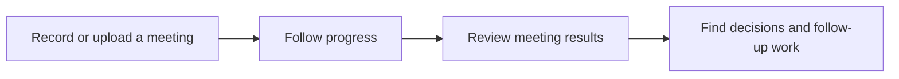

## What it is

Sensio Notes records or imports a meeting and turns it into a summary, decisions, and action items you can search later.
I work on it as part of a team with AI, infrastructure, security, and UI/UX engineers.

## What I worked on

My part is getting a recording into the system safely and keeping the user informed until the results are ready.

- **Uploads that survive a bad connection.** Recordings over 100 MB are sent in parts. After a dropped connection, the upload continues from the last finished part, and retries respect the server's backoff.
- **No lost meetings.** An in-progress recording is backed up locally on web and mobile, so a crash or a closed tab does not lose it.
- **Progress and errors people can read.** The interface separates work that is continuing, work that needs attention, and results that are ready, and it keeps web and mobile behavior consistent.

I also take part in testing, diagnosing production issues, and releases. The AI features are built by other members of the team.

## Links

- Product: [sensio.id](https://sensio.id)
