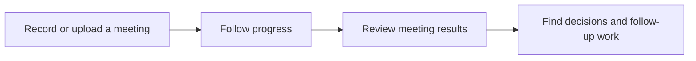

## What it is

Sensio Notes records or imports a meeting and turns it into a summary, decisions, and action items you can search later.
I work on it as part of a team with AI, infrastructure, security, and UI/UX engineers.

## What I Did

- Developed Sensio Notes end-to-end, covering frontend, backend, AI integration, and infrastructure.
- Built cross-platform meeting recording for web and mobile, including a Chrome extension for Google Meet.
- Implemented AI-powered transcription, speaker identification, meeting summaries, action items, and decision extraction.
- Developed agentic AI chat using LangGraph, tool calling, and Graph RAG with hybrid search across meeting data.
- Built meeting intelligence features including interactive knowledge graphs, mind maps, searchable transcripts, and AI chat with source references.
- Implemented background processing, reliable audio uploads, real-time status updates, and containerized deployment.

## Links

- Product: [sensio.id](https://sensio.id)
