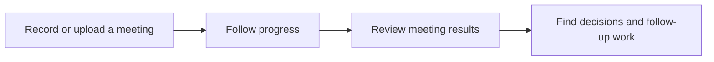

## From a meeting to something people can use

A meeting can contain useful decisions and follow-up work, but finding them again takes time. People need a record they can review without replaying the entire conversation.

**Sensio Notes** helps turn meeting content into summaries, action items, and searchable information. Our team works on the product across application engineering, AI, infrastructure, security, and UI/UX.

My contribution is the application experience that connects those capabilities: helping users capture a meeting, understand progress, and return to the results.

## The meeting experience

The user starts with a recording or an uploaded file, follows its progress, and reviews the available results. Clear feedback matters throughout that journey, especially when processing takes longer than a normal interaction.

This diagram describes the user journey. It does not represent the internal service architecture.

## Capture before interpretation

A useful summary begins with a usable recording. Long sessions, interrupted connections, and differences between web and mobile use make that a practical engineering concern.

I work on recording and upload interactions with attention to progress feedback, interruption handling, and recovery. The goal is to help users understand what has been preserved and what still needs their attention.

## Making progress understandable

Processing should not leave users guessing. The interface needs to distinguish work that is continuing, work that needs attention, and results that are ready to review.

My backend and client work connects application state to those visible outcomes. That includes keeping feedback consistent and making errors understandable, while coordinating integration work with the engineers responsible for the other product capabilities.

## Failure handling is part of the product flow

An interrupted connection can change what a user sees without explaining what happened. A mobile app can also behave differently from a browser during a long session.

I investigate those application behaviors and work with the team on recovery and feedback. The engineering question is how to help someone continue their task after an interruption without making them reconstruct the meeting workflow themselves.

## Turning transcripts into meeting knowledge

The product helps people review summaries, decisions, and follow-up work alongside the meeting record. Search makes that information easier to revisit later.

My responsibility is the application integration and presentation of those results. AI capabilities are developed collaboratively; their implementation remains attributed to the team members responsible for them.

## Ownership inside a cross-functional team

I contribute backend and fullstack implementation within a team that also includes AI, infrastructure, security, and UI/UX specialists.

Designers provide the visual and interaction direction. I connect that direction to application behavior, including progress, loading, errors, and recovery across web and mobile use.

I coordinate with other engineers when a problem crosses the application boundary. Delivering the product depends on that shared work.

## What I worked on

My work includes backend application behavior, web and mobile integration, recording and upload interactions, progress feedback, and interrupted-work recovery.

I also contribute to testing, application diagnosis, and release coordination with the wider team. These responsibilities describe my contribution without exposing internal service arrangements or customer environments.

## The boundary that mattered most

Capture reliability and the usefulness of generated results require separate attention. Users need confidence in the meeting record before they can rely on the information derived from it.

That principle guides how I approach the application: preserve a clear user journey, make progress visible, and help people review the result.

## Links

- Sensio Platform: [sensio.id](https://sensio.id)
